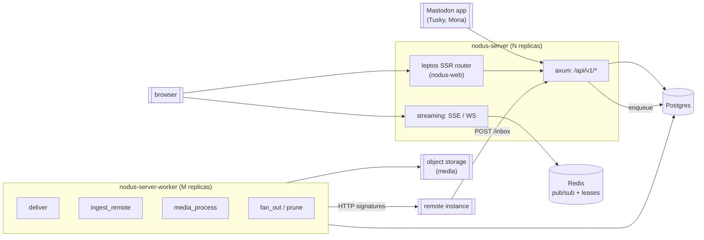

# 01 — Architecture

Status: draft · Last revised: 2026-11-07

One binary serves the client API, another runs jobs. Both are stateless apart from
Postgres, so both scale by replica count. The frontend is mounted into the first
binary rather than served by a separate process, because a page that renders a
timeline is a request that already has the data.

## Crates

| Crate | Purpose | Rule |
| --- | --- | --- |
| `nodus-server-core` | ids, visibility, sanitisation, pagination arithmetic, `Instance` config | no I/O, no async, unit-testable |
| `nodus-server-store` | sqlx, migrations, every SQL statement | the only crate that names a table |
| `nodus-server-api` | axum router, extractors, error mapping, streaming | no SQL, no domain decisions |
| `nodus-server-federation` | ActivityPub documents, signatures, inbox handlers, delivery | no SQL |
| `nodus-server-worker` | job loop, lease, retry policy | composes store + federation |
| `nodus-server` | binary: config, migrations, mount, shutdown | wiring only |

The dependency direction is one-way: `server → api → store → core`, and
`worker → federation → core`. `api` never depends on `worker`; the two meet at the
`job` table, which is the only queue.

## Request path

1. **Auth.** Bearer token → `oauth_token` lookup (cached for 60 s by token digest).
   Missing or expired is `401` with the Mastodon error body, never an HTML page.
2. **Scope.** Route → required scope, checked before the handler runs. `read` for
   GETs, `write` for POSTs, `follow` for relationship changes.
3. **Handler.** Loads through `store`, decides through `core`, writes DTOs typed by
   the `nodus-sdk` shared contract. A handler that needs more than one write does it
   in one transaction through a single store function.
4. **Fan-out.** A local write enqueues `fan_out` in the same transaction; the
   worker writes `timeline_entry` rows. A request never fans out inline, because a
   post with 40 000 followers must not turn into a 40 000-row insert inside the
   user's request.
5. **Streaming.** `fan_out` publishes to Redis; the streaming handler forwards to
   connected SSE/WS clients. POSTs to `/api/v1/statuses` return before any of this.

## Why the database is the queue

The `job` table with `FOR UPDATE SKIP LOCKED` and a lease (`locked_until`,
`attempts`) is enough for delivery, ingest and fan-out:

- it commits atomically with the domain write that produced it;
- a crashed worker's lease expires and another picks the row up;
- backlog is observable with one `GROUP BY`, no extra component;
- Kubernetes scaling is "more worker pods", not "more consumers on a broker".

Redis is used for what it is good at — pub/sub for streaming, short-lived locks —
never as the source of truth. If Redis is down, timelines still work and only
cross-replica streaming degrades.

## Process model

- **Async, multi-threaded:** Tokio's multi-thread runtime, worker threads default to
  CPU count. Blocking work (image decode, signature verification over large bodies)
  goes through `spawn_blocking`; a handler does no CPU work over ~1 ms.
- **Graceful shutdown:** SIGTERM stops accepting, finishes in-flight requests, and
  releases job leases by rolling back their transactions. A worker that is killed
  mid-job loses the job, not the data.
- **Health:** `/healthz` (process alive), `/readyz` (database reachable, migrations
  at head, and — in the worker — lease acquisition working).

## Relationship to `nodus-recommender`

They are **independent deployments**. This server owns its schema; the recommender
owns its own, and neither imports the other's migrations. If an operator wants
Nodus recommendations on their instance, the recommender is pointed at this server's
database as a read-only consumer and serves its feed API beside it — it is not a
dependency, and a deployment without it is a normal Mastodon instance.

The consequence to accept: no shared `app_user` table, no foreign keys across the
two. The recommender's `sync_user` job reads this server's `follow` table through a
role that has `SELECT` only.

## Deployment

Kubernetes by default: `Deployment` for `nodus-server` (HPA on CPU + request rate),
`Deployment` for `nodus-server-worker` (HPA on job backlog, not CPU), one
`StatefulSet` for Postgres, `Ingress` terminating TLS. Redis is optional in M0.
Migrations run as a `Job` before rollout, `nodus-server --migrate-only`. The full
manifest set and its reasoning live in `docs/05-workers.md`.
