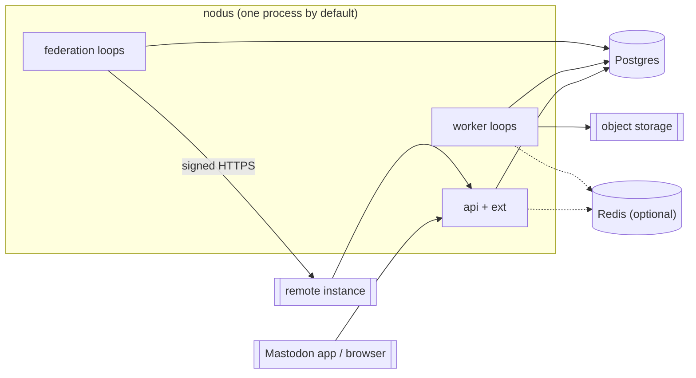

# 09 — Deployment topology

Status: design · Last revised: 2026-11-13

The default deployment is a **monolith**: one `nodus` process, one Postgres, and an
optional Redis. Federation and the Nodus extensions are capabilities of that process,
not separate services. Splitting roles out is an operational choice for scale or
isolation, never a requirement for a working instance.

## One binary, several roles

```text
nodus --roles=api,worker,federation
```

| Role | Responsibility |
| --- | --- |
| `api` | Mastodon client API, OAuth, ActivityPub inbox/outbox, Nodus extensions |
| `worker` | Postgres job loop: fan-out, delivery, ingest, media, prune |
| `federation` | federation-specific workers and scheduler |
| `web` | optional SSR mount; absent in API-only deployments |

With no `--roles`, all roles run in one process. The same code runs in every role;
the flag only decides which loops and routers start. In-process calls use the same
traits as the out-of-process transport, so a monolith is not a separate
implementation with separate bugs.



## Split topology, when it is justified

The split profile is one **database service** and N **logic services**, talking
gRPC:

```text
                    ┌────────────────────┐
  clients ────────▶ │ nodus-api (N)      │
                    │ stateless          │
                    └─────────┬──────────┘
                              │ gRPC (domain RPCs)
                    ┌─────────▼──────────┐
                    │ nodus-store (1)    │
                    │ schema + queries   │
                    └─────────┬──────────┘
                              │ SQL
                           Postgres

  federation workers (N) ────┘
  media workers (N) ─────────┘
```

- The gRPC boundary exposes **domain operations** (`load_home`, `create_status`,
  `claim_jobs`), never raw SQL or a generic query language. A database service that
  accepts SQL over gRPC has all the coupling of a shared database plus a network
  hop.
- `nodus-store` is the only process with database credentials in split mode. It
  owns migrations and transactions; the logic services own HTTP, rendering and
  policy.
- The API is stateless. Streaming state is in Redis, durable state is in Postgres,
  and any replica can serve any request.
- The in-process implementation and the gRPC client implement the same Rust trait.
  `--topology=single` selects the in-process one; `--topology=split` requires
  `NODUS_STORE_URL`.
- gRPC is internal: mTLS or a private network, no public listener. The public
  contract stays HTTP/ActivityPub.

### Why not microservices by default

Every extra process adds a failure mode, a deploy step and a version skew. A single
instance's traffic does not need independent scaling of reads and writes. Start with
the monolith; split the store first when database connection pressure or blast-radius
isolation demands it, then workers by queue class.

## Media

Media is **not** a single global service. It is a stateless worker pool over shared
object storage:

- upload writes a `media_attachment` row and a `media_process` job;
- any media worker can claim the job, fetch the object, produce variants, write
  blurhash and update the row;
- blobs are keyed by SHA-256, so duplicate uploads converge on one object;
- the API serves URLs from object storage or a caching proxy, not from the worker.

A single media service would be a throughput bottleneck and a single point of
failure for every image on the instance. Co-locating media workers with the
monolith is fine at small scale; scaling them out is just more replicas. A GPU
transcode pool is a separate worker class if it is ever needed.

## Redis: which workers need it

Postgres is the source of truth for jobs, timelines, sessions and sync logs. Redis
is a fast, lossy coordination layer and is **optional**; losing it degrades
streaming and rate limiting, not data.

| Worker / role | Uses Redis for | If Redis is down |
| --- | --- | --- |
| `stream` / event fan-out | pub/sub across API replicas, resume cursor cache | each replica serves only its own connections; clients reconnect and resync |
| `deliver` | per-host token bucket, short lease hints | fall back to Postgres lease and a local rate limiter |
| `ingest_remote` | dedupe/in-flight marker, negative cache | duplicate fetches are possible; still correct |
| `media_process` | hot digest lookup, progress marker | redo work; object store digest remains authoritative |
| `prune` / scheduler | singleton lock | Postgres advisory lock is the fallback |
| API read cache | short-lived instance/relationship cache | read Postgres |

The `stream` and `deliver` workers are the two that benefit most: the first needs
cross-replica fan-out, the second needs a rate limiter shared by every replica.
Neither may make Redis authoritative. A Redis flush must be a cache miss, not data
loss.

## Federation surface: full, limited, off

Federation is a runtime policy and a compile-time capability:

```text
NODUS_FEDERATION=off       no inbox/outbox, no remote fetch; local-only instance
NODUS_FEDERATION=limited   allowlist or outbound-only; see below
NODUS_FEDERATION=full      normal ActivityPub delivery and discovery
```

The binary can be built without federation support at all
(`--no-default-features --features api,worker`). In that build the routes are not
registered, not merely rejected.

`limited` covers the common "small instance" policies:

- **allowlist**: only listed domains may deliver or be fetched;
- **outbound-only**: local posts may be delivered to followed remote actors, but
  unsolicited inbound activities are rejected;
- **read-only public**: WebFinger and actor documents are served, inbox delivery is
  accepted only for follows already established;
- **forwarding**: an operator can forward a restricted set of endpoints to another
  host (for example, a hosted media proxy or an existing moderation service)
  instead of enabling the full local implementation.

Endpoint forwarding is explicit per route, not a generic reverse proxy. The
forwarded request keeps its signature and body; the local server still enforces
auth, rate limits and the allowlist. A forwarded endpoint that is unavailable is a
`503`, never a silent local fallback with different semantics.

## Federation workers

Federation is not one loop. Each class has its own failure behaviour and can scale
independently:

| Worker | Work | Retry / ordering |
| --- | --- | --- |
| `inbox` | verify signature/digest, dedupe activity id, apply in one transaction | fast reject; duplicate is a no-op |
| `deliver` | one signed POST per inbox, shared inbox preferred | per-host queue, Retry-After, exponential backoff, 10 attempts |
| `fetch_actor` | WebFinger + actor document, key refresh | 15 min cache, one refetch on signature failure |
| `fetch_status` | status/thread backfill by URI | 5 min cache, bounded depth |
| `sync` | hash-diff backfill from a peer | forward from known hash, resumable |
| `media_cache` | remote attachment mirroring | content-addressed, no duplicate download |
| `prune` | dead followers, expired keys, old tombstones | singleton |

All of them use the same Postgres lease queue as local workers. The `deliver`
worker is the only one that talks to arbitrary remote hosts, so it gets the per-host
concurrency limit and the Redis token bucket; a hostile instance must not delay
deliveries to everyone else.

## Smallest deployment

One LXC/VM:

```text
nodus --roles=api,worker,federation --listen 0.0.0.0:3000
postgresql (local)
redis (optional, local)
object storage (local filesystem or S3)
```

For a single-user or small instance this is the recommended shape. No Kubernetes,
no service mesh, no gRPC.

## Kubernetes shape

When the monolith is no longer enough:

| Workload | Replicas | Scales on |
| --- | --- | --- |
| `nodus-api` | N | CPU + request rate |
| `nodus-store` | 1 (or 2 behind a leader) | connections / write latency |
| `nodus-worker` | M | job backlog by kind |
| `nodus-federation` | F | federation backlog, per-host fairness |
| `nodus-media` | K | media backlog |
| `nodus-auth` | optional | OIDC provider for SSO; failure blocks new logins, not existing tokens |
| `nodus-web` | included in API | request rate |
| Postgres | 1 primary + replicas | storage / read replicas |
| Redis | 1 + replica | optional |

Migrations run as a one-shot `nodus migrate` job before rollout. Workers from the
previous release may still be running, so migrations stay additive within a
release, as in `docs/04-storage.md`.

## Failure rules

- **Postgres unavailable:** API returns `503`; workers stop claiming; no writes are
  accepted. This is the only hard dependency.
- **Redis unavailable:** streaming reconnects and resyncs; delivery uses the
  Postgres lease and a local limiter; reads still work.
- **Object storage unavailable:** new media jobs retry; existing timelines still
  render text and cached URLs.
- **Store service unavailable (split):** API returns `503`; it does not fall back to
  a local database connection, because that would fork the source of truth.
- **Federation peer unavailable:** delivery backs off; sync diff resumes from the
  last acknowledged hash. Local posting never waits for a remote host.
- **External IdP unavailable:** existing scoped tokens keep working; new browser
  logins fail closed. The Mastodon client flow does not depend on the IdP after a
  token is issued.

## Configuration sketch

```toml
[server]
listen = "0.0.0.0:3000"
roles = ["api", "worker", "federation"]
topology = "single"          # single | split

[store]
url = "postgres://nodus@localhost/nodus"
grpc_listen = "127.0.0.1:50051"   # split only

[redis]
url = "redis://localhost:6379"    # omitted = disabled

[federation]
mode = "full"                # off | limited | full
allowlist = []
forward = {}                 # route -> upstream, limited mode only

[extensions]
enabled = ["batch", "events", "state_sync"]
```
